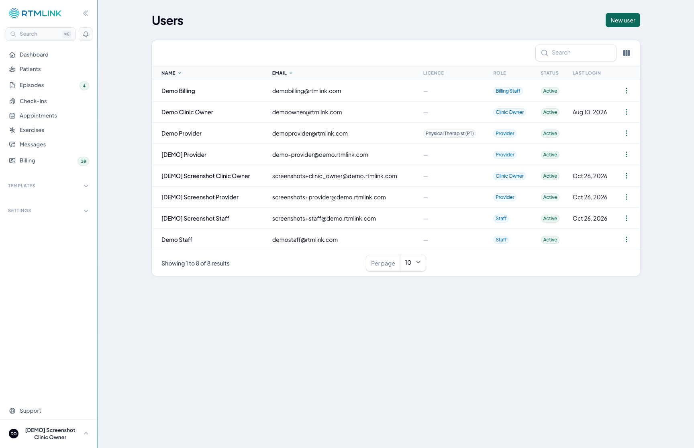

# Adding team members

New team members are invited, not assigned a password. You add them with a role, RTMLink emails them a secure sign-in link, and they choose their own password from it.

## Inviting someone

1. Open **Settings** > **Users** in the left sidebar.
2. Click **New user**.
3. Fill in the **User Details**:
   - **Name** (required)
   - **Credentials** (optional): the letters that appear after their name, such as "PT" or "DPT". This is display text only.
   - **Licence level** (optional): their clinical licence, used for billing attribution (see below). Leave it on **Not set** for non-clinical staff, or pick **Non-clinical staff**.
   - **Supervising therapist**: appears only when you pick an assistant licence level, and is required there. Choose the therapist who supervises them.
   - **Employment** (optional): **Employed by the practice** or **Contractor**.
   - **Email** (required, and unique within your clinic)
   - **Role** (required): pick one, see [The roles](#the-roles) below.
4. Click **Create**. RTMLink emails the new member a welcome message with a sign-in link.

> **Credentials and Licence level are different fields.** **Credentials** is free text shown next to the person's name. **Licence level** is a set choice that RTMLink uses for billing, so set it for anyone who logs clinical time.

## The roles

| Role | For |
| --- | --- |
| **Clinic Owner** | full run of the clinic, including team and settings |
| **Provider** | reviews their patients, logs time, signs their claims |
| **Staff** | front-desk and patient support, no billing |
| **Billing Staff** | claims and billing, read-only on clinical records |
| **Auditor** | read-only across the whole clinic |

For what each role can do in detail, see [Understanding your role](../getting-started/understanding-your-role.md).

> A role and a licence level are separate. A Physical Therapist Assistant can hold any role, but is never billed as the independent provider.

## Licence level and billing

The **Licence level** choices are **Physical Therapist (PT)**, **Physical Therapist Assistant (PTA)**, **Occupational Therapist (OT)**, **Occupational Therapy Assistant (OTA / COTA)**, **Speech-Language Pathologist (SLP)**, **Speech-Language Pathology Assistant (SLPA)**, and **Non-clinical staff**.

A few rules follow from the licence level:

- **Assistants need a supervising therapist.** When you pick PTA, OTA, or SLPA, the **Supervising therapist** field appears and must be filled. You can only choose a therapist of the matching discipline (a PTA is supervised by a PT, an OTA by an OT, an SLPA by an SLP).
- **Assistant minutes can change a claim.** When a PTA or OTA furnishes more than a small share of a billed unit, that unit carries an extra billing code on the claim. Setting the licence level correctly keeps those claims accurate.
- **An SLPA cannot hold a time-logging role.** If you set the licence level to SLPA and also try to give the **Provider** role, RTMLink blocks it, because Medicare does not recognise SLPA-furnished services.

## How the new member gets in

The welcome email, subject **Your RTMLink account is ready**, contains a one-time sign-in link. The link opens a page where they set their own password, and from then on they sign in normally. You never see or set their password. See [Logging in and setting up your account](../getting-started/logging-in-and-account-setup.md) for the new member's side of this.

> The sign-in link works once and expires after 48 hours. If it expires before they use it, open the **Users** list, find the person, and choose **Send welcome email** from their actions menu to send a fresh link (see [Managing your team](managing-your-team.md)).

## Who can add team members

Adding and inviting team members is a Clinic Owner task.

## Related articles

- [Managing your team](managing-your-team.md)
- [Understanding your role](../getting-started/understanding-your-role.md)
- [Logging in and setting up your account](../getting-started/logging-in-and-account-setup.md)
- [Managing your account](../settings/managing-your-account.md)
